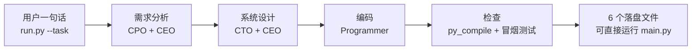

# ChatDevLite_24201538

软件项目管理实验一：项目范围管理 —— ChatDev 的轻量版。

原版 [OpenBMB/ChatDev](https://github.com/OpenBMB/ChatDev) 是大模型多智能体协作开发，
功能全，但依赖多、要配 API Key、要启动服务，课堂演示成本高。
轻量版只保留实验单要求的那条主线：**一句话需求 → 需求分析 → 系统设计 → 编码 → 检查**，
其余全部砍掉，换来三个好处：零第三方依赖、不用 Key 就能跑、每一步结果都落盘可查。

## 快速开始

```bash
# 要求 Python 3.10 以上，不用装任何包
python run.py --task "开发一个待办事项命令行工具"
python run.py --demo   # 不想想需求时，直接跑待办示例

# 跑完去看生成的东西，再亲手跑一遍生成的程序
cd outputs/开发一个待办事项命令行工具
python main.py add "买牛奶"
python main.py list
```

一次运行产出 6 个文件：

| 文件 | 谁产出 | 内容 |
|---|---|---|
| requirements.md | CPO + CEO | 需求文档：功能、非功能、验收标准、不做清单 |
| design.md | CTO + CEO | 系统设计：模块、数据模型、示例命令、测试计划 |
| main.py | Programmer | 真正能跑的代码，不是占位符 |
| check.md | 流水线 | py_compile + 冒烟命令的结果 |
| conversation.md | 四个角色 | 对话记录 |
| pipeline.json | 流水线 | 本次运行的元数据 |

## 流水线可视化



WBS 表和图见 [docs/wbs.md](docs/wbs.md)，完整范围说明（含用例图、开发模型论述）
见 [docs/scope.md](docs/scope.md)，与 AI 对话的记录摘要见 [docs/ai_dialogue.md](docs/ai_dialogue.md)。

## 轻量化的取舍（这正是实验要讲的“范围”）

| 原版 ChatDev | ChatDevLite |
|---|---|
| 大模型多轮对话、多种角色 | 4 个角色、确定性模板，本地可复现 |
| Web 界面 / 服务 | 只有命令行，不启动服务 |
| 多种语言、复杂项目 | 单文件 Python + 一个 JSON 数据文件 |
| 需 API Key、联网 | 零依赖、离线可跑 |
| 成本高、结果不稳定 | 每次跑同一需求，结果一致，方便讲思路 |

**代价也要说清楚**：模板生成不是通用大模型，只能覆盖待办、计算器、猜数字、
记账、通用条目这几类命令行工具。复杂需求、图形界面、联网功能不在范围，
需要人工在生成的 main.py 上继续改 —— 这恰好是“范围边界”的例子。

## 目录

```
run.py                  主入口
chatdevlite/
  agents.py             四个角色 + 需求/设计/编码模板
  pipeline.py           串联流水线 + 检查 + 落盘
docs/
  scope.md              项目范围说明书
  wbs.md                工作分解结构 (WBS)
examples/demo_todo/     待办示例的一次真实运行结果
```

## 实验信息

- 课程：软件项目管理，实验一：项目范围管理
- 学号：24201538
- 讲解视频：见仓库外提交的 5 分钟内 mp4（开发思路 + 可视化演示）
