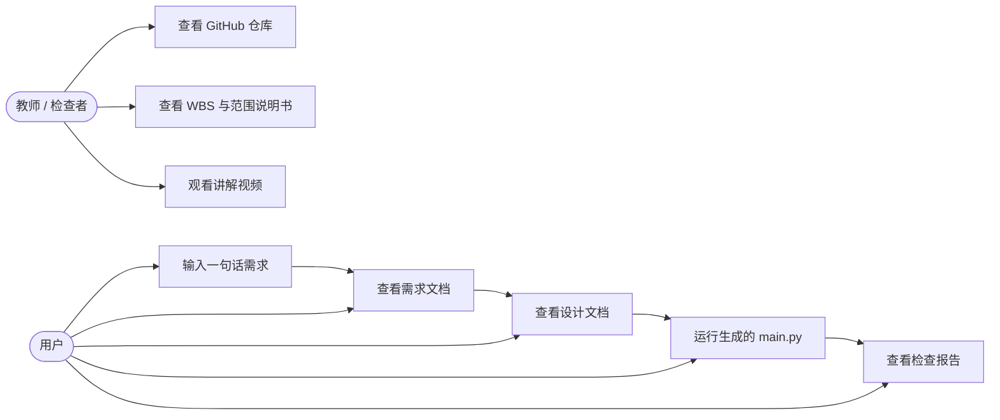

# 项目范围说明书：ChatDevLite_24201538

软件项目管理实验一：项目范围管理。原版调研对象为 OpenBMB/ChatDev，
本仓库为其轻量版，代码为实验原创实现，没有复制原版代码。

## 1. 目标及系统描述

### 1.1 目标（简述主要功能的介绍）

一方面，项目要打通一条最短的端到端软件开发流程：
**需求分析 → 系统设计 → 编码 → 代码审查 → 自动化测试 → 文档生成**。
用户只给一句话，系统按顺序产出需求文档、设计文档、可运行代码和检查报告，
让“用 AI 做软件开发”这件事在课堂上能当场演示、能复现。

另一方面，代码审查与自动化测试要收敛成轻量、可验证的形式：
不启动服务、不依赖外部模型，用 `py_compile` 语法检查加一条确定性冒烟命令，
就能判断生成的代码是不是真的能跑。少量投入、可持续反馈，
这正是轻量版相对原版的最大取舍。

本项目由 CPO、CTO、Programmer 等多智能体角色分工完成开发，
与“设计稿清晰、易扩展”的目标一致：以后要接真实大模型，
只需替换 `chatdevlite/agents.py` 里的模板函数，流水线接口不用变。

### 1.2 主要功能模块及其描述

| 编号 | 模块 | 角色 | 输入 | 输出 |
|---|---|---|---|---|
| 1.1 | 主入口 | 用户 | `python run.py --task "…"`（需求描述作参数传入） | 任务描述文本 + 输出目录 |
| 1.2 | 需求分析 | CPO + CEO | 任务描述 | 需求文档 `requirements.md`（含范围说明：做 / 不做） |
| 1.3 | 系统设计 | CTO + CEO | 需求文档 | 设计文档 `design.md`：模块、数据模型、示例命令、测试计划 |
| 1.4 | 编码 | Programmer | 设计文档 | 源代码 `main.py`（按设计一次写出完整文件） |
| 1.5 | 审查与测试 | 流水线 | `main.py` | 检查报告 `check.md`：py_compile + 冒烟测试结果 |
| 1.6 | 文档与可视化 | 流水线 | 全部中间产物 | `conversation.md`、`pipeline.json`、WBS 图、本说明书 |

### 1.3 用例图

参与者只有两类：**用户**（提需求、跑程序的人）和**教师 / 检查者**
（看仓库、看文档、看视频的人）。内部的 CPO、CEO、CTO、Programmer
是系统内部角色，不画成外部参与者，这样用例图才符合“从使用者角度看系统”的要求。

用例说明：

| 用例 | 参与者 | 前置条件 | 成功结果 |
|---|---|---|---|
| 输入一句话需求 | 用户 | Python 3.10 以上 | 流水线开始运行 |
| 查看需求 / 设计文档 | 用户、教师 | 流水线已跑完 | 文档内容与需求一致 |
| 运行生成的 main.py | 用户 | 输出目录已生成 | 示例命令跑出预期结果 |
| 查看检查报告 | 用户、教师 | 流水线已跑完 | check.md 写明通过 / 失败项 |
| 查看仓库、WBS、视频 | 教师 | 已提交 | 能独立复现一次运行 |

## 2. 软件开发模型

**采用：增量模型为主，结合小步迭代。**

理由按本项目特点逐条说：

- **需求相对清楚，但细节要试了才知道**：实验单已定死主线
  （需求 → 设计 → 编码 → 检查），不适合完全等需求冻结的瀑布模型；
  但范围又不像真实客户项目那样随时大变，也不适合纯敏捷、无固定终点的做法。
- **每个模块都能独立交付、可演示**：先交主入口 + 待办模板这个最小可用增量，
  再增量加计算器、记账、猜数字模板，每增量都跑一次完整检查，
  老师随时能看到一个能跑的版本，而不是等到最后才看到成品。
- **风险低、反馈快**：模板覆盖面有限是已知风险，增量交付能早发现
  （例如猜数字是交互程序，不能自动冒烟，就在增量里改成“只做语法检查”），
  而不是最后才返工。

不采用的模型：瀑布模型（后期改模板代价大、演示来得太晚）；
纯敏捷开发（本实验范围、学号、交付物都已固定，不需要持续变更需求来驱动）。

## 3. 工作分解结构 (WBS)

WBS 按功能模块划分，采用“自上而下”的创建方式，完整表和图见
[docs/wbs.md](wbs.md)。这里只列一级分解，细节以 WBS 文件为准：

| WBS 编码 | 工作包 | 交付物 |
|---|---|---|
| 1.1 | 主入口与命令行 | run.py |
| 1.2 | 需求分析 | requirements.md |
| 1.3 | 系统设计 | design.md |
| 1.4 | 编码 | main.py |
| 1.5 | 审查与测试 | check.md |
| 1.6 | 文档与可视化 | README、范围说明书、WBS、讲解视频 |

## 4. 范围边界与验收

**做**：命令行工具；单文件 Python；本地 JSON 持久化；待办、计算器、
猜数字、记账、通用条目五类模板；离线演示。

**不做**：图形界面、Web 服务、账号登录、联网同步、数据库服务、
多用户权限、通用大模型调用（留作扩展接口，不在本实验实现）。

**验收标准**：

- `python run.py --demo` 在无网络、无 API Key 的机器上跑通。
- 生成的 `main.py` 通过 `py_compile`，示例命令结果与设计文档一致。
- 输出目录 6 个文件齐全，任何一步都可单独打开检查。
- 讲解视频在 5 分钟以内，讲清开发思路并展示可视化结果。

**假设与局限**：假设运行环境为 Python 3.10 以上，无需第三方包。
局限要如实写进报告：模板生成覆盖面有限，复杂需求仍需人工改代码；
猜数字类交互程序不做自动冒烟，只做语法检查，避免流水线卡在等待输入上。

**附录**：与 AI 对话的记录见 [docs/ai_dialogue.md](ai_dialogue.md)。
