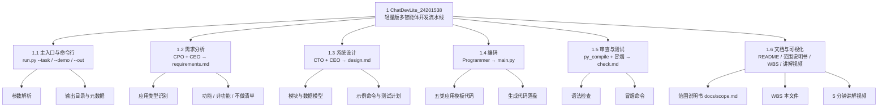

# 工作分解结构 (WBS)：ChatDevLite_24201538

自上而下分解，先定总目标，再拆到可交付、可验收的工作包。
WBS 以功能模块进行划分，参考教材的自上而下创建方式。

## 工作分解结构 (WBS) 表

| WBS 编码 | 工作包 | 负责人（角色） | 交付物 |
|---|---|---|---|
| 1 | ChatDevLite_24201538 轻量版 | 全体 | 可运行的仓库 |
| 1.1 | 主入口与命令行 | 用户 / 流水线 | run.py |
| 1.1.1 | 参数解析 | 流水线 | `--task`、`--demo`、`--out` |
| 1.1.2 | 输出目录与元数据 | 流水线 | pipeline.json |
| 1.2 | 需求分析 | CPO + CEO | requirements.md |
| 1.2.1 | 应用类型识别 | CPO | 待办 / 计算器 / 猜数字 / 记账 / 通用 |
| 1.2.2 | 功能 / 非功能 / 不做清单 | CPO + CEO | 需求文档三项齐全 |
| 1.3 | 系统设计 | CTO + CEO | design.md |
| 1.3.1 | 模块与数据模型 | CTO | 单文件 + JSON 模型 |
| 1.3.2 | 示例命令与测试计划 | CTO | design.md 示例命令 |
| 1.4 | 编码 | Programmer | main.py |
| 1.4.1 | 五类应用模板代码 | Programmer | 可运行的 main.py |
| 1.4.2 | 生成代码落盘 | 流水线 | 输出目录 main.py |
| 1.5 | 审查与测试 | 流水线 | check.md |
| 1.5.1 | 语法检查 | 流水线 | py_compile 通过 |
| 1.5.2 | 冒烟命令 | 流水线 | 示例命令跑通 |
| 1.6 | 文档与可视化 | 流水线 / 作者 | README、范围说明书、WBS、视频 |
| 1.6.1 | 范围说明书 | 作者 | docs/scope.md |
| 1.6.2 | WBS 表与图 | 作者 | 本文件 |
| 1.6.3 | 5 分钟讲解视频 | 作者 | mp4（开发思路 + 可视化） |

## 工作包验收

| 工作包 | 交付物 | 验收方法 |
|---|---|---|
| 1.1 | run.py | `--help`、`--demo` 能跑 |
| 1.2 | requirements.md | 功能、验收、不做三项齐全 |
| 1.3 | design.md | 模块、模型、示例命令齐全 |
| 1.4 | main.py | 能按示例命令跑出结果 |
| 1.5 | check.md | py_compile + 冒烟全部通过 |
| 1.6 | docs + 视频 | 文档可读，视频 < 5 分钟 |
